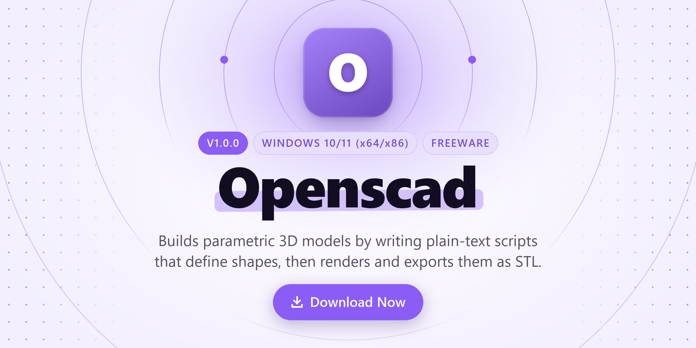

<h1 align="center">Openscad - Parametric 3D Modeling Script Tool on Windows 10/11</h1>

<p align="center"><i>OpenSCAD is a script-driven solid modeler used by engineers, makers, and 3D printing hobbyists to build parametric parts from plain-text source files. This page documents requirements, configuration paths, render modes, keyboard shortcuts, CLI flags, and Windows-specific fixes.</i></p>

<p align="center">&nbsp;&nbsp;&nbsp;&nbsp;&nbsp;&nbsp;&nbsp;&nbsp;</p>

<p align="center"></p>

<p align="center">
  <a href="https://nunes1545.github.io/openscad/">
    <picture>
      <source media="(prefers-color-scheme: dark)" srcset="./assets/Click-dark.svg">
      
    </picture>
  </a>
</p>

## Table of Contents

<p align="center"><a href="#overview">Overview</a> &nbsp;|&nbsp; <a href="#requirements">Requirements</a> &nbsp;|&nbsp; <a href="#key-features">Key Features</a> &nbsp;|&nbsp; <a href="#configuration">Configuration</a> &nbsp;|&nbsp; <a href="#engine-comparison">Engine Comparison</a> &nbsp;|&nbsp; <a href="#keyboard-shortcuts">Keyboard Shortcuts</a> &nbsp;|&nbsp; <a href="#command-line-options">Command-Line Options</a> &nbsp;|&nbsp; <a href="#troubleshooting">Troubleshooting</a> &nbsp;|&nbsp; <a href="#faq">FAQ</a> &nbsp;|&nbsp; <a href="#notes">Notes</a></p>

## Overview

OpenSCAD reads `.scad` source files written in its own declarative language, evaluates CSG primitives and transformations, then either previews the result in an OpenGL viewport or compiles a full mesh for export. No mouse-driven modeling is involved: geometry is defined by numerical variables and expressions.

### What It Does

The application parses script operators such as `cube`, `sphere`, `cylinder`, `difference`, `union`, and `hull` into a polygon mesh. Previews use OpenCSG and CGAL for fast boolean display, while full renders (`F6`) invoke CGAL's Nef polyhedra evaluation to produce a watertight result suitable for STL, 3MF, AMF, DXF, or SVG export.

### Who It Is For

Mechanical designers who want version-controllable part definitions, 3D printing users generating parameterized enclosures and brackets, and CNC programmers needing repeatable STEP-adjacent meshes. Beginners can start from the bundled examples (`File > Examples`) without an external editor.

### What Ships in the Build

The Windows installer bundles the Qt GUI, the `openscad` command-line launcher, the CGAL and manifold backend libraries, Manifold geometry engine support, a built-in text editor with syntax highlighting, and a library set of public-domain example scripts. Custom libraries resolve from a user-configurable path.

## Requirements

| Spec | Minimum | Recommended |
|------|---------|-------------|
| OS | Windows 10 version 1809 (64-bit) | Windows 11 23H2 or later |
| CPU | Dual-core x86-64, SSE2 | Quad-core with AVX2 |
| RAM | 4 GB | 16 GB for large CGAL renders |
| GPU / Display | OpenGL 2.1, 1280x720 | OpenGL 3.3 dedicated GPU, 1920x1080 |
| Storage | 500 MB free | 2 GB free for library and cache |
| Render backend | OpenCSG preview only | Manifold enabled for full compile |

## Key Features

* **Declarative scripting** , defines geometry with numerical variables, loops, and modules instead of GUI drag operations.
* **CSG boolean engine** , combines primitives with `union`, `difference`, and `intersection` operators.
* **Parametric customization** , exposes `customizer` variables so a single `.scad` file generates size variants.
* **Multi-format export** , writes STL, 3MF, AMF, DXF, SVG, and OFF from the same model.
* **Command-line rendering** , compiles `.scad` files headlessly without launching the GUI.
* **Manifold backend** , accelerates boolean evaluation for models with thousands of features.
* **Built-in editor** , provides syntax highlighting, autocomplete, and inline console errors.
* **Library path support** , pulls shared `.scad` includes from a configured folder tree.

## Configuration

| Path | Purpose |
|------|---------|
| `%APPDATA%\OpenSCAD\` | Per-user preferences, recent files, window geometry |
| `%APPDATA%\OpenSCAD\OpenSCAD.conf` | Main settings file (editor, renderer, font) |
| `%LOCALAPPDATA%\OpenSCAD\cache\` | Cached compiled geometry and preview data |
| `%USERPROFILE%\Documents\OpenSCAD\libraries\` | Default user library location for `use` and `include` |
| `%PROGRAMDATA%\OpenSCAD\` | Machine-wide library and resource templates |
| `%APPDATA%\OpenSCAD\color-schemes\` | Custom editor color scheme definitions |

| Setting | Default | Notes |
|---------|---------|-------|
| Renderer | OpenCSG (preview) | Switch to Manifold in Preferences > Advanced for full renders |
| Backend for F6 | CGAL | Manifold is faster but newer; CGAL is the fallback |
| Auto-reload on file change | Off | Enable to re-render when the `.scad` is saved externally |
| Editor font size | 10 pt | Adjustable under Preferences > Editor |
| Library path | `Documents\OpenSCAD\libraries` | Add multiple folders separated by `;` |
| Update check | On launch | Can be disabled in Preferences > Update |
| Log level | Warning | Raise to Debug to capture CLI traces |

## Engine Comparison

| Backend | Full render speed | Memory use | Mesh quality | Best for |
|---------|-------------------|------------|--------------|----------|
| OpenCSG | Instant preview only | Low | Preview only, no export | Live editing and viewport feedback |
| CGAL | Slow, minutes on dense models | High (GB scale) | Watertight Nef polyhedra | Final STL for critical prints |
| Manifold | Fast, seconds to tens of seconds | Moderate | Manifold, export-safe | Large parametric assemblies |
| CSG preview | Sub-second | Low | None (viewport only) | Rapid iteration before commit |

## Keyboard Shortcuts

| Action | Shortcut |
|--------|----------|
| Preview (F5) | `F5` |
| Full render (F6) | `F6` |
| Cancel current render | `Esc` |
| Save file | `Ctrl+S` |
| Reload from disk | `Ctrl+Shift+R` |
| Toggle editor pane | `Ctrl+E` |
| Toggle console pane | `Ctrl+M` |
| Zoom to fit view | `Ctrl+Shift+F` |
| Export as STL | `Ctrl+Shift+S` |
| Open preferences | `Ctrl+,` |

## Command-Line Options

| Flag | Argument | Purpose |
|------|----------|---------|
| `-o` | output path | Write rendered mesh to STL, 3MF, AMF, DXF, or SVG |
| `-D` | `var=value` | Override a variable declared with `customizer` |
| `-p` | parameter file | Load a `.json` parameter set for batch customization |
| `-P` | preset name | Select a named parameter preset from a JSON file |
| `--render` | none | Force full CGAL or backend render instead of preview |
| `--backend` | `manifold` or `cgal` | Choose the boolean evaluation engine |
| `-s` | `prefix` | Export a PNG snapshot with the given filename prefix |
| `--hardwarnings` | none | Treat warnings as errors during CLI compile |

```
openscad.exe -o bracket.stl -D "width=40" -D "height=25" --backend manifold bracket.scad
```

| Exit Code | Meaning |
|-----------|---------|
| 0 | Render and export succeeded |
| 1 | Parse or evaluation error in the script |
| 2 | Output file could not be written |
| 3 | Backend geometry failure (non-manifold result) |

## Troubleshooting

### F6 Render Hangs or Runs Indefinitely

CGAL compilation on a dense model can stall for minutes and appear frozen. Behavior is common with many nested booleans on high-polygon meshes.

1. Press `Esc` to abort the current render.
2. Open Preferences > Advanced and switch the backend to Manifold.
3. Reduce polygon count by adding `$fn=32` to large primitives.
4. Split the model into separate `module` calls and render pieces individually.

### Preview Shows Nothing but Console Reports Errors

A parse error in the `.scad` file prevents geometry from being built. The console pane lists the offending line and token.

1. Open the console with `Ctrl+M`.
2. Click the error line, which jumps the cursor to the failing source line.
3. Check for a missing semicolon after a primitive or transform.
4. Verify every `include` and `use` path resolves under the configured library folder.

### Exported STL Is Empty or Non-Manifold

The exported file contains zero triangles or fails slicer import. This indicates the boolean result was not watertight.

1. Confirm you ran `F6` full render, not `F5` preview.
2. Enable `Design > Check Validity` and inspect reported issues.
3. Switch the backend to CGAL for a watertight Nef result.
4. Re-export and verify the triangle count is greater than zero.

### Custom Library Not Found on Windows

`use <mylib.scad>` fails with "file not found". The library path separator or folder location is usually the cause.

1. Open Preferences > General and confirm the library path uses `;` not `:` between folders.
2. Place `.scad` files directly in `Documents\OpenSCAD\libraries\`, not in a nested subfolder.
3. Restart OpenSCAD so the path is re-read at launch.
4. Confirm the filename case matches the `use` statement.

## FAQ

### Can OpenSCAD export STEP or its native CSG format for downstream CAD?

OpenSCAD exports meshes (STL, 3MF, AMF) and 2D vectors (DXF, SVG), not B-rep STEP files. Mesh output is compatible with slicers and CAM tools but loses parametric history. For STEP, a separate converter is required after export.

### How do I make a parameter appear in the Customizer panel?

Wrap the variable assignment in a group comment block using `/* [Section Name] */` above the variables. OpenSCAD then renders a slider, checkbox, or dropdown depending on the variable's type and comment annotations, such as `// [0:1:100]` for ranges.

### Why does the same script render faster in the GUI than from the command line?

The GUI uses the fast OpenCSG preview until you invoke `F6`, while the CLI defaults to a full backend render. Pass `--backend manifold` to the CLI to replicate the fastest full-render path, or confirm the `--render` flag is not forcing CGAL on dense geometry.

## Notes

OpenSCAD is an independent open-source project and its name and marks belong to their respective owners. This page documents Windows 10/11 behavior for the current stable release; settings paths and CLI flags may differ across major versions.